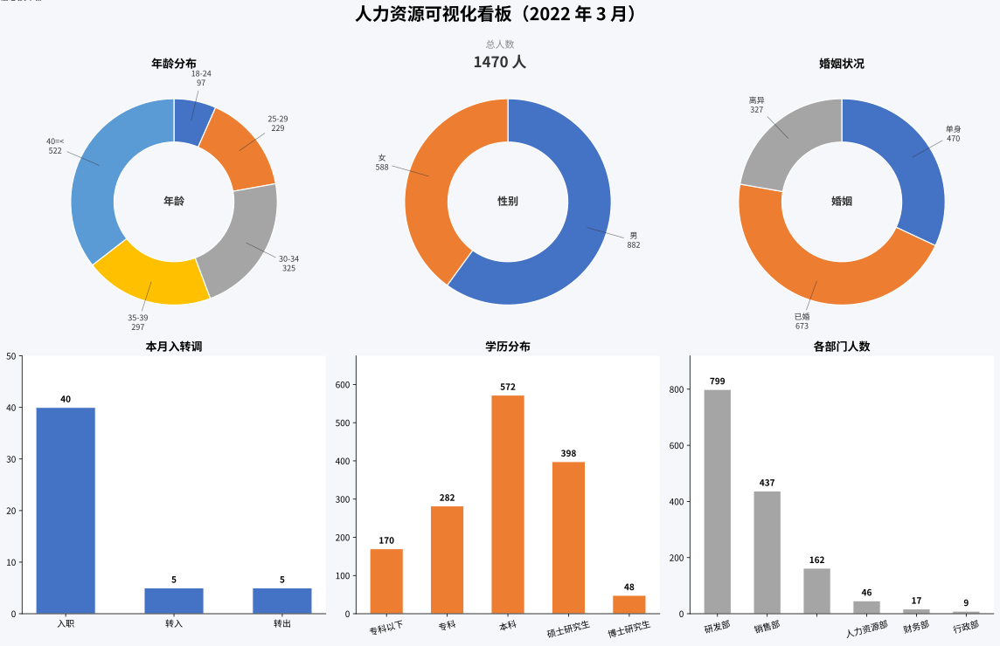
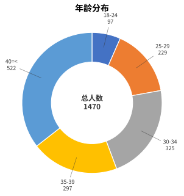
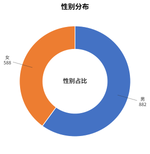
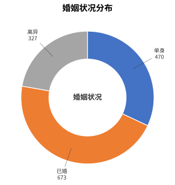
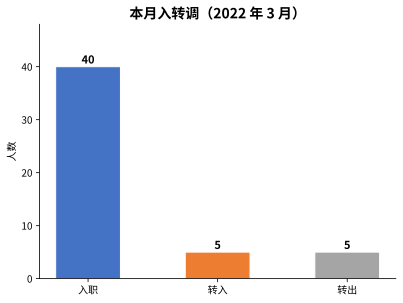
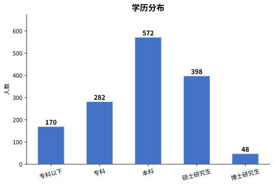
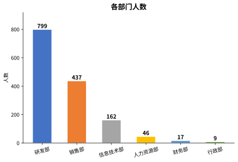

# 第四章 数据看板复现（Python 版）

用 Python（pandas + Matplotlib）复现《Excel 数据可视化》第四章的两个综合看板：**人力资源可视化看板**与**销售数据大屏**。所有汇总数字均由 pandas 从明细数据现场计算，并与原 Excel 看板中的结果逐项核对一致（核对明细见 [第四章看板复现-详细说明.md](第四章看板复现-详细说明.md)）。

## 目录结构

```
├── charts/                          # 16 个可独立运行的脚本
│   ├── common.py                    # 公共配置：配色、深色主题、环形图 / KPI 卡片、数据读取
│   ├── hr/                          # 人力资源可视化看板（6 张图 + 1 个总装看板）
│   │   ├── 01_年龄分布环形图.py
│   │   ├── 02_性别分布环形图.py
│   │   ├── 03_婚姻状况环形图.py
│   │   ├── 04_入转调柱形图.py
│   │   ├── 05_学历分布柱形图.py
│   │   ├── 06_部门人数柱形图.py
│   │   └── 07_人力资源看板.py        # 总装：总人数卡片 + 6 图整屏看板
│   └── sales/                       # 销售数据大屏（8 张图 + 1 个总装看板）
│       ├── 01_各月销售额面积图.py
│       ├── 02_产品类别销量环形图.py
│       ├── 03_利润额占比销售额环形图.py
│       ├── 04_成本类别占比环形图.py
│       ├── 05_区域销量条形图.py
│       ├── 06_快递公司销量条形图.py
│       ├── 07_销量环比图.py
│       ├── 08_商品销售额Top3条形图.py
│       └── 09_销售数据看板.py        # 总装：5 张 KPI 卡 + 8 图深色大屏
├── data/                            # 原始明细数据（由课程 Excel 文件导出，未做任何改动）
│   ├── 人力资源明细.csv              # 1470 名员工 × 8 个字段
│   ├── 销售明细.csv                  # 8564 条订单 × 10 个字段
│   └── 成本明细.csv                  # 12 个月 × 4 个成本类别
├── images/                          # 运行脚本后生成的图表（SVG 入库；PNG 本地生成）
├── run_all.py                       # 一键运行全部 16 个脚本
├── requirements.txt
└── README.md
```

## 快速开始

```bash
pip install -r requirements.txt

# 运行任意一个脚本，图片会保存到 images/ 目录（PNG + SVG 各一份）
python charts/hr/01_年龄分布环形图.py
python charts/sales/09_销售数据看板.py

# 一键运行全部 16 个脚本
python run_all.py
```

销售看板的展示月份由 `charts/common.py` 中的 `MONTH` 变量控制（默认 `"9月"`，
对应 Excel 看板的月份选择控件），修改为任意月份即可复现该月的看板。

## 整屏效果

### 人力资源可视化看板



### 销售数据大屏（2021 年 9 月）


## 图表清单（人力资源可视化看板）

| # | 图表 | 脚本 | 效果 |
|---|------|------|------|
| 01 | 年龄分布环形图 | `charts/hr/01_年龄分布环形图.py` |  |
| 02 | 性别分布环形图 | `charts/hr/02_性别分布环形图.py` |  |
| 03 | 婚姻状况环形图 | `charts/hr/03_婚姻状况环形图.py` |  |
| 04 | 本月入转调柱形图 | `charts/hr/04_入转调柱形图.py` |  |
| 05 | 学历分布柱形图 | `charts/hr/05_学历分布柱形图.py` |  |
| 06 | 部门人数柱形图 | `charts/hr/06_部门人数柱形图.py` |  |
| 07 | 人力资源看板总装 | `charts/hr/07_人力资源看板.py` |  |

## 图表清单（销售数据大屏）

| # | 图表 | 脚本 | 效果 |
|---|------|------|------|
| 01 | 各月销售额面积图 | `charts/sales/01_各月销售额面积图.py` |  |
| 02 | 产品类别销量环形图 | `charts/sales/02_产品类别销量环形图.py` |  |
| 03 | 利润额占比销售额环形图 | `charts/sales/03_利润额占比销售额环形图.py` |  |
| 04 | 成本类别占比环形图 | `charts/sales/04_成本类别占比环形图.py` |  |
| 05 | 区域销量条形图 | `charts/sales/05_区域销量条形图.py` |  |
| 06 | 快递公司销量条形图 | `charts/sales/06_快递公司销量条形图.py` |  |
| 07 | 销量环比图 | `charts/sales/07_销量环比图.py` |  |
| 08 | 商品销售额 Top3 条形图 | `charts/sales/08_商品销售额Top3条形图.py` |  |
| 09 | 销售数据看板总装 | `charts/sales/09_销售数据看板.py` |  |

## Excel → Python 机制对照

| Excel 看板机制 | Python 等价实现 |
|---|---|
| COUNTIFS 辅助计数表 | `value_counts` / `groupby().size()` |
| 数据透视表（月份/区域/类别汇总） | `groupby(...).sum()` / `.size()` |
| 差值校验列（各维度合计 = 总数） | 脚本内 `assert` 断言，运行即自动核对 |
| 圆环图（含辅助段 1−占比） | `pie(wedgeprops=dict(width=0.42))` |
| 面积图 | `fill_between` + `plot` |
| 顶部指标卡 / 卡片图 | `FancyBboxPatch` 圆角矩形 + `fig.text` |
| 月份选择控件 | `charts/common.py` 中的 `MONTH` 变量 |
| 深色底数据大屏 | `common.py` 的 `DARK_BG` 深色主题 |

## 说明

- `data/` 中三个 CSV 由课程配套 Excel 原样导出（人力资源 1470 行、销售 8564 行、成本 48 行），未做任何删改；所有图表数字均由脚本从明细重新计算，而非抄录 Excel 结果。
- 每个脚本独立可运行，导入 `charts/common.py` 获取统一配色、深色大屏主题与输出工具；图片同时输出 PNG 与 SVG（仓库仅入库 SVG，PNG 在本地运行 `run_all.py` 时生成）。
- 销售看板 Excel 原文件中的「数据大屏」工作表由 11 张图表 + 图片形状拼成，本仓库按相同信息结构复现为 `09_销售数据看板.py` 整屏图；个别仅起装饰作用的元素（背景图片、占位辅助区）不作复现，依据详见 [第四章看板复现-详细说明.md](第四章看板复现-详细说明.md)。
- 字体自动回退（Microsoft YaHei / PingFang SC / Noto Sans CJK SC / SimHei），Windows、macOS、Linux 均可正常显示中文。

## License

MIT
